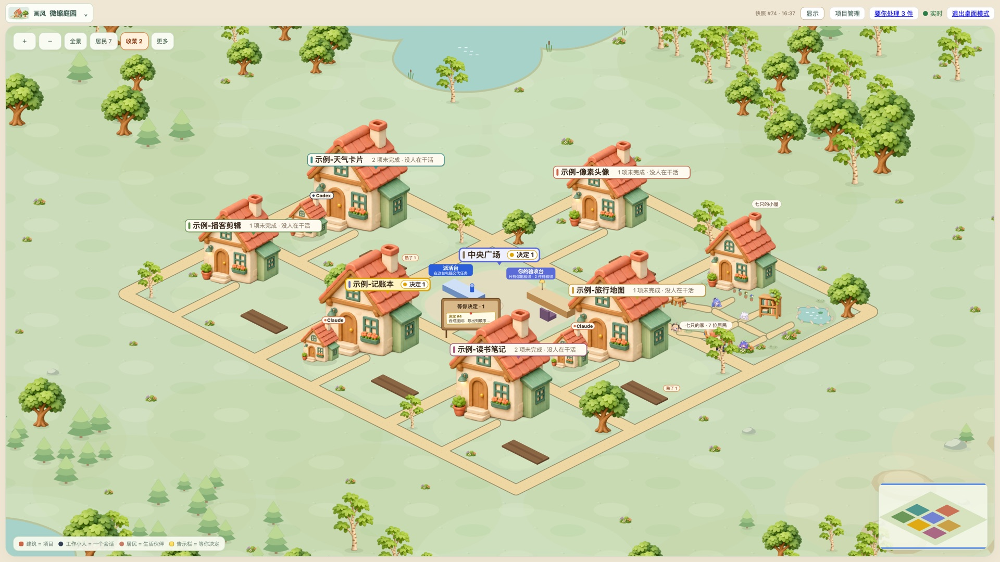
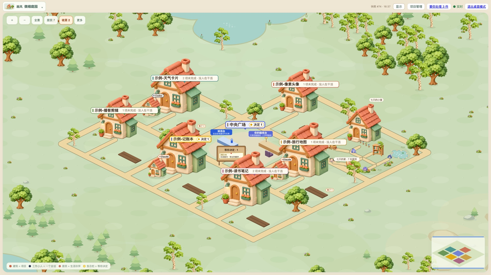
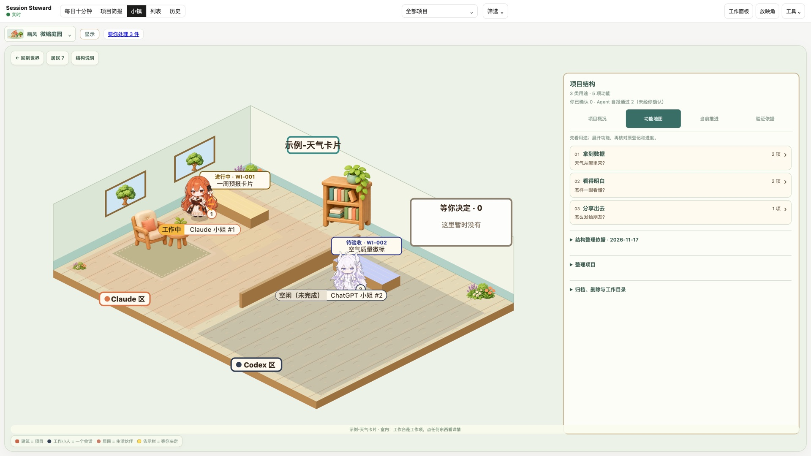

# Session Steward · SS Town

> **Project status**　Session Steward is complete and in maintenance mode. Feature development has ended, and the app remains [available to download and use](https://github.com/xoqiu09/session-steward/releases/tag/v0.3.0-rc.17).

**Running several Claude Code and Codex sessions at once? Put them in a little town.**

Every project is a house. Every agent session is a worker at its door. Permission requests and questions get pinned to the board in the town square, and finished deliveries grow into ripe vegetables in the garden. Instead of flipping through a dozen terminals, one glance tells you **who is doing what, what is stuck, and whose move it is next.**

[Download the App](https://github.com/xoqiu09/session-steward/releases/tag/v0.3.0-rc.17) · [Try the demo](#try-the-demo-first) · [Design notes (Chinese)](docs/DESIGN-NOTES.zh-CN.md) · [Video storyboard (Chinese)](docs/DEMO-VIDEO.zh-CN.md) · [中文说明](README.md) · MIT



> **v0.3.0-rc.17 public trial** · macOS 13+ (Apple silicon / Intel) · **Chinese UI for now** · local-only, no telemetry, no account · requires Claude Code or Codex. This is a pre-release; please tell us where you got stuck in [Issues](https://github.com/xoqiu09/session-steward/issues).

## Why

AI coding has moved from "one assistant beside you" to "several agents working across several projects at the same time." The human becomes the bottleneck: which window is waiting for a permission? Which agent said "done" without verifying anything? Which one has been idle for half an hour?

SS doesn't write code for you, and it doesn't make decisions for you. It does one thing: **puts the state of parallel agent work on one map, and gathers everything that needs your attention in one place.**

## What it does

| | |
| --- | --- |
| 🏘 **One map for everything** | House = project, worker = session (shown as Claude-chan / ChatGPT-chan). Projects you often work on together form villages. Houses stay where they are. |
| 📌 **What needs you, in one place** | Tool permissions, agent questions and pending merges show up on the square's board and in the side queue. Allow, deny, or jump back to the original session. |
| 🥬 **"The agent says done" ≠ you approved it** | Deliveries grow into ripe vegetables. "Harvest" walks you through what was delivered, where to look and how to verify. Only you can mark work as handled; a stopped or silent session never counts as done. |
| 🏠 **Walk into a project** | Each room has four tabs: overview, feature map, current work, and evidence. Agent-reported progress and your acceptance are recorded separately. |
| 🔔 **Gentle reminders** | Menu bar and a top "island" remind you about deliveries left unharvested for 30 minutes and work that has stalled on you. Things you already handled in the original session clear themselves. |
| 🎨 **Six art styles, seven residents** | Miniature Garden, Storybook, Cozy Night, Picture Book, Classic and AI Studio. Seven residents stroll the roads and visit projects. Entirely local; no model calls. |



## Built for multi-agent work

- **Many agents, many projects, one screen.** Claude Code and Codex (desktop or CLI) register their own tasks, report progress and deliver results through hooks. Each agent gets its own workshop in a project; when work is handed off between them, a little cart carries the work item across.
- **Dispatch desk (local Codex).** Hand a task to the Codex on this machine from the town square. Each task gets its own branch and worktree; anything Codex wants to run still waits for your decision.
- **Bounded background follow-up (experimental, off by default).** Give a work item a goal, a turn budget and a deadline, and SS can queue follow-up input for the responsible Codex worker and run read-only checks. It never approves tool permissions for you and never treats an agent's report as acceptance.
- **Humans step in only when needed.** Everything that needs you is counted the same way everywhere: formal requests, items an agent handed to you, deliveries awaiting review, and stalled work.



## Install in three steps

You need macOS 13+ and Claude Code or Codex (either one, desktop or CLI).

1. **Download** `Session-Steward_v0.3.0-rc.17_macOS_arm64.app.zip` (Apple silicon) or `…_amd64.app.zip` (Intel) from the [release page](https://github.com/xoqiu09/session-steward/releases/tag/v0.3.0-rc.17), unzip, and drag **Session Steward** into Applications.
2. **First launch.** The App is not yet signed or notarized by Apple, so macOS will stop it once:
   - Right-click Session Steward in Applications → Open → Open; or
   - double-click once, then go to System Settings → Privacy & Security and click "Open Anyway"; or
   - from Terminal, remove the download quarantine flag for this App only:

     ```sh
     xattr -dr com.apple.quarantine "/Applications/Session Steward.app"
     ```

   Signing needs a paid Apple Developer account; it will come once enough people are trying SS, together with in-app updates.
3. **Follow the onboarding and click "安装 hooks 并开始" (install hooks and start).** It tells you which two files it changes (`~/.claude/settings.json` and `~/.codex/hooks.json`), backs them up first, and only adds Steward's own entries. Codex users also need to trust the new hooks in Codex.

Then start a Claude Code or Codex session and give it some work. A house and a worker appear in the town.

## Try the demo first

After the first launch you can explore a fictional town without installing hooks:

```sh
"/Applications/Session Steward.app/Contents/MacOS/steward" demo
```

Or from source (Go 1.26.5+; the frontend is prebuilt in the repo):

```sh
go build -o bin/steward ./cmd/steward
bin/steward demo
```

The demo creates a fresh temporary directory with three fictional projects. It does not read real sessions, install hooks, call models, start agents or touch `~/.steward`. Press Ctrl+C to stop.

## Privacy and security

- Runs only on your machine, listens on loopback only, and rejects requests whose `Host` is not loopback. No telemetry.
- Separate random tokens (mode `0600`) for hooks and for the panel; the panel uses an HttpOnly, SameSite=Strict cookie and checks `Origin` on writes.
- Stores redacted event metadata (event type, tool name, fingerprints, truncated previews with secrets masked), not raw payloads or full conversations.
- Report security issues privately per [SECURITY.md](SECURITY.md).

## Known limitations

- Not signed or notarized yet; no in-app updates.
- macOS only; the UI is Chinese for now.
- Agents must follow the hook instructions to register and report, otherwise the town stays quiet.

## Development

```sh
make build   # npm ci && npm run build in web/, then go build
make test    # go test -race ./... and npm test in web/
sh scripts/build-app.sh   # package the App into dist-app/
```

Tests and demos use synthetic data only; see [AGENTS.md](AGENTS.md).

## License

Source code: [MIT](LICENSE). The seven residents' artwork is licensed separately under CC BY-NC-SA 4.0 (from CrossPet) and is not relicensed under MIT; see [attribution](web/public/residents/ATTRIBUTION.md) and [license](web/public/residents/LICENSE.md).
