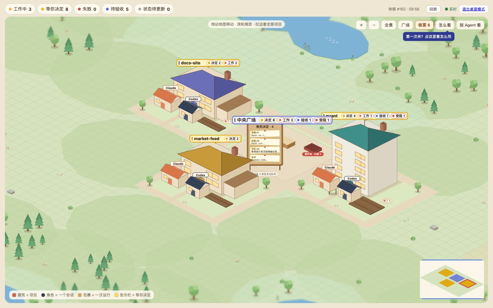
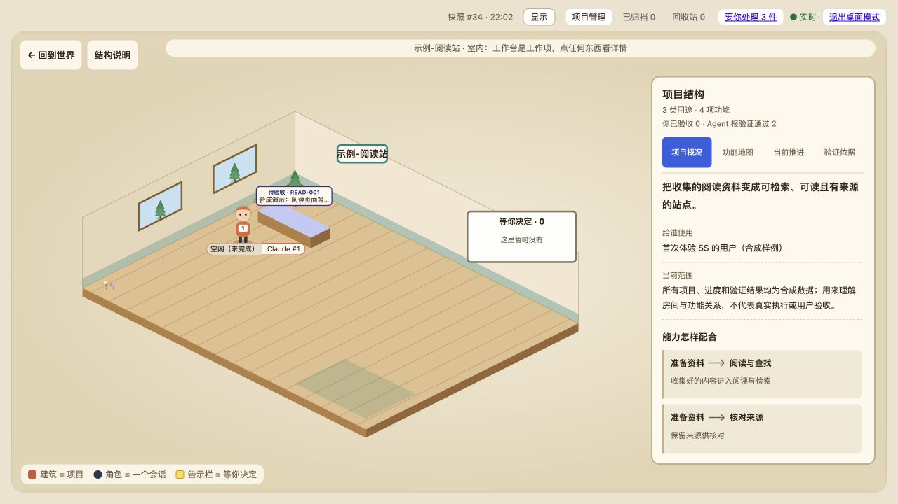
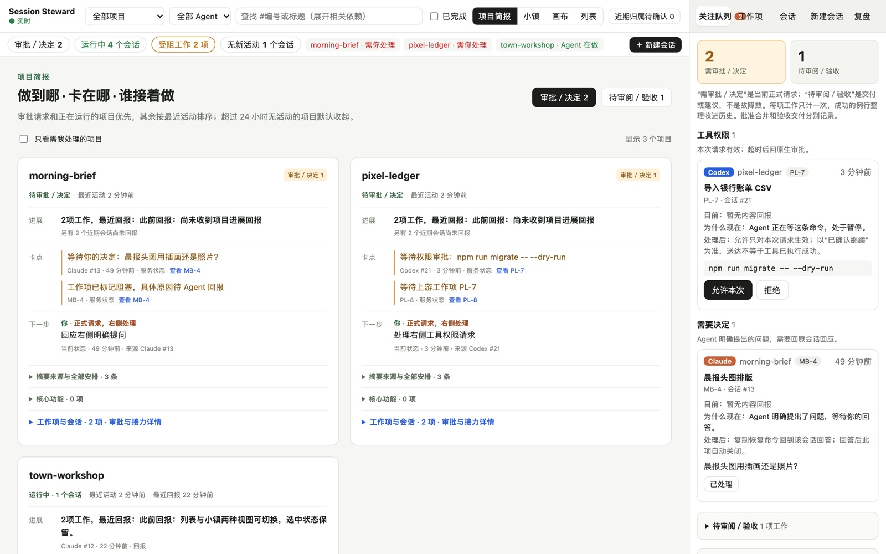

# Session Steward

给 Claude Code 和 Codex 用的本机项目进展台。几个 Agent 同时在几个项目里工作时，你可以在一座小镇里看清：**项目是做什么的、功能怎样配合、工作推进到哪里、下一步该谁处理。**

[首次使用](docs/FIRST-USE.zh-CN.md) · [合成演示](docs/DEMO.zh-CN.md) · [试用反馈](docs/TRYOUT.zh-CN.md) · [完整手册](docs/GUIDE.zh-CN.md) · [安全策略](SECURITY.md) · MIT · [English](#english-summary)

> **新试用版候选，尚未发布安装包。** 本文的项目目录和新版演示对应当前源码；公开下载仍是 [v0.2.0](https://github.com/xoqiu09/session-steward/releases/tag/v0.2.0)，不包含这次完整的结构体验。候选先完成独立复核，再生成新安装包。
>
> App 支持 macOS 13+（Apple 芯片 / Intel），界面为中文。默认资料留在本机，无遥测，不需要 SS 账号；首次接入需要你已有 Claude Code 或 Codex。



## 先看懂一个项目，再看进展

房子代表项目，进入房间后按四个入口阅读：

| 入口 | 帮你回答 |
| --- | --- |
| 项目概况 | 项目解决什么问题，给谁用，主要能力怎样配合？ |
| 功能地图 | 功能按什么用途分类？展开后，每项实现和验证到哪里？ |
| 当前推进 | 正在做哪项工作，谁在推进，卡在哪，下一步是什么？ |
| 验证依据 | 结论来自哪次回报、哪个版本？哪些仍待你确认？ |

**结构资料和工作进度分开。** 目录由你或当前开发 Agent 整理；SS 不会安装后自动读完所有源码、生成整齐的项目房间。没有资料时显示“尚未整理”，没有登记功能也不等于项目未开发。保存目录不改变任务或验收。



<details>
<summary>继续了解进度、提醒与审批</summary>

- **一张地图看全部工作。** 房子是项目，小人是正在干活的会话，熟了的菜是等你看的交付，广场上的告示栏是等你决定的事。房子的位置固定，不会因为状态变化跑来跑去。
- **有新进展时带你去看。** 某个项目交付了，镜头会飞到那栋房子；你正在拖地图或读东西时不会抢镜头，看完点“回到刚才的位置”。
- **忘了的事会再提醒。** 小镇顶部的“灵动岛”会提醒你：交付熟了 30 分钟还没收、工作停了 30 分钟没人推而下一步该你、交付后你已经回到对话接着推进（问你这件算不算处理了）。适合挂在副屏上常开。
- **项目有自己的说明与功能目录。** 每个房间都能整理目标、用途与功能关系，资料可导入导出；[项目结构整理说明](docs/project-structure.md)。
- **看得到每个项目的核心功能。** Agent 按功能回报“已完成 / 开发中 / 未开始”和验证情况；鼠标移到房子上就能看到，进入房子能看全部。这些是 Agent 自述，你验收过的才标“你已验收”。
- **等你的事集中在一处。** 工具权限请求、Agent 的提问、等批准的合并、等你看的交付，都在面板右侧的队列里，可以直接允许、拒绝或处理。
- **“Agent 说做完了”不等于你点了头。** 进展和交付由 Agent 自己回报，只有你能把工作标为“已处理”。会话停止、沉默或空闲都不算完成。
- **按项目看简报。** 每个项目显示阶段、一句话结论、卡点、下一步和该谁动手，而不是一长串会话。

</details>



## 三步装好

需要：macOS 13 或更新版本，以及 Claude Code 或 Codex（任一即可，桌面版和命令行版都行）。以下下载步骤适用于已公开的 v0.2.0，能体验基础小镇与进度功能；当前候选的新结构体验先从源码演示检查。

1. **下载。** 打开 [Releases](https://github.com/xoqiu09/session-steward/releases)，下载 v0.2.0 里对应芯片的 `Session-Steward_v0.2.0_macOS_arm64.app.zip`（Apple 芯片）或 `…_amd64.app.zip`（Intel）。解压后把 **Session Steward** 拖进“应用程序”。
2. **第一次打开。** 这个版本没有 Apple 签名和公证，macOS 会拦一下：
   - 在“应用程序”里**右键 Session Steward → 打开 → 打开**；
   - 如果没有“打开”按钮（较新的 macOS）：先双击一次，再到“系统设置 → 隐私与安全性”，在下方找到 Session Steward，点“仍要打开”。
3. **按引导点“安装 hooks 并开始”。** 引导会先说明要改哪两个文件（`~/.claude/settings.json` 和 `~/.codex/hooks.json`），改之前会备份，只添加 Steward 自己的条目。用 Codex 的话，还要在 Codex 里信任新加的 hooks。

装好后新开一个 Claude Code 或 Codex 会话，让它干点活，小镇里就会出现房子和小人。刚装好时小镇是空的，这是正常的：数据来自你自己的会话，作者电脑上的项目目录不会随安装包提供。想先看看效果，见下面的[合成演示](#先用演示数据看一眼)。

<details>
<summary>想自己从源码打包 App</summary>

需要 `git`、Go 1.26.5 及以上，以及 Xcode 命令行工具（`xcode-select --install`）。前端已经构建好放在仓库里，不需要 Node。

```sh
git clone https://github.com/xoqiu09/session-steward
cd session-steward
sh scripts/build-app.sh
```

产物在 `dist-app/Session Steward.app`。把它拖进“应用程序”，然后从上面第 2 步继续。
</details>

## 先用演示数据看一眼

在这份候选源码中构建一个命令行程序，需要 Go 1.26.5+；前端已构建并提交，不需要 Node。运行演示不需要 Claude Code、Codex、Python、curl 或 Git。

```sh
go build -o bin/steward ./cmd/steward
bin/steward demo
```

它会选一个空闲的本机端口、创建全新的临时目录并打开浏览器。只有三个虚构项目：

- **示例-阅读站**：看完整的概况、用途分组、功能关系和等待查看的交付。
- **示例-发布清单**：看卡点、下一步和一个合成提问。
- **示例-素材册**：已有两项功能，目录尚未整理；按[首次使用](docs/FIRST-USE.zh-CN.md#练习整理示例素材册)导入样例，体验从空目录到可读房间。

演示复用原有结构与状态接口，但不读取真实会话、不安装 hooks、不调用模型、不启动真实 Agent，也不修改 `~/.steward`。进度和验证结果都是合成状态，操作只影响这份演示库。

按 Ctrl+C 停止。数据目录会打印在终端并保留给你复核；再次运行会创建另一份新演示。只启动、不打开浏览器可用 `bin/steward demo --no-open`。自定义新目录、结束方式与旧脚本兼容说明见[演示说明](docs/DEMO.zh-CN.md)。

## 用起来

### 整理自己的第一个项目

1. 在一个允许修改的项目里新开 Claude Code 或 Codex 会话，给它一件小任务，确认对应项目和会话出现在小镇。
2. 进入房间，展开“整理项目”，点“给 Agent 的整理说明”，把生成的内容复制给**正在开发这个项目的同一个 Agent**。
3. 让它依据项目说明和已有功能登记，提出目标、用途分组、功能关系与依据。可以通过结构接口回报建议，也可以交给你导入预览；不确定的地方保留待核对。
4. 读概况、展开分组，试着沿关系讲清项目。保存只改变说明和分类，不改变任务或验收；手工修改后，Agent 不能直接覆盖。

具体步骤、可复制的补充要求、成功画面和空态排查见[首次使用](docs/FIRST-USE.zh-CN.md)。JSON 格式与接口见[项目结构资料](docs/project-structure.md)。

### 跑通第一个真实任务

1. 新开一个 Claude Code 或 Codex 会话，像平时一样给它任务。
2. hooks 会在会话开始时给 Agent 一段说明，Agent 会自己登记任务、回报进展、做完时交付。小镇里出现一栋房子，门口有正在干活的小人。
3. Agent 需要权限时，告示栏上会多一张卡片，面板右侧的队列里可以直接允许或拒绝。
4. Agent 交付后，菜地里的菜会“熟了”。点“收菜”逐个查看交付了什么、在哪看、怎么验证；看过没问题点“已处理”，不行就“退回”。

更细的说明和常见问题见[使用手册](docs/GUIDE.zh-CN.md#先用一个真实任务验证价值)。

### 小镇

App 打开就是小镇的世界地图。

| 地图上的东西 | 意思 |
| --- | --- |
| 房子 | 一个项目。越大说明未完成的工作和最近的活动越多：小木屋 → 房子 → 工坊 → 大楼 |
| 村庄 | 最近常一起开发、互相有关的几个项目，围着一口井 |
| 野外的小屋 | 7 天没动静的项目 |
| 中央广场 | 全镇合计、验收台、告示栏（等你决定的事） |
| 小人 | 一个会话，衣服颜色表示是哪个 Agent |
| 熟了的菜 | 一个等你看的交付 |
| 红白路障 | 有受阻的工作 |
| 门口的“停着 N” | 有工作停在你手上：没做完、没人在推、30 分钟没动静，下一步该你 |
| 退件筐、小纸箱 | 最近失败的运行、正在进行的运行（默认隐藏，在“显示”里打开） |
| 灰色、云朵 | 很久没有新事件，不当作还在工作 |

常用操作：

- **拖动和缩放**：拖动地图移动，滚轮缩放；“全景”看全部，“广场”回到中间。
- **点项目名牌**：镜头飞到那栋房子和门前的菜地，人还在世界里；点**片区名牌**（例如“xx 一带 · 7 个项目”）看整片。看完点“回到刚才的位置”。
- **鼠标移到房子上**：显示项目概况：几个 Agent 在做、核心功能已完成 / 开发中 / 未开始、Agent 建议的下一步。
- **点房子本身**或“进入工作室”：走进项目内部，工作台是工作项，墙上白板是等你决定的事，右侧按“项目概况 / 功能地图 / 当前推进 / 验证依据”阅读；展开“整理项目”可导入或修改该项目的目录。房间内“结构说明”展示所属项目；按 Esc 出来。
- **点小人**：打开会话详情，可以回到原来的会话接着干。
- **收菜 N**：逐个打开等你看的交付；旁边显示最久的一件等了多久，超过 30 分钟变红。
- **按 Agent 看**、**怎么看**（小镇里的完整说明）。
- **显示**：状态筛选、回放（看过去某一刻的小镇）、包裹和退件筐默认收起，要用时在这里打开，设置记在浏览器里。

房子的位置会记在浏览器里，刷新或重开 App 后还在原处；看过的动态不会重复飞过去。所有没归档的项目都会留在地图上，不想看到某个项目就在完整面板的“项目”里归档它，随时可以恢复。

### 灵动岛提醒

| 提醒 | 什么时候出现 | 你可以 |
| --- | --- | --- |
| 等你决定 | Agent 要权限或在问你 | 去处理 |
| 你回来过 | 交付以后，你又回到交付的那个会话发了消息 | 已处理、退回修改、看看，或稍后（不点也行，它留在待验收里） |
| 停在你手上 | 工作没做完、没 Agent 在跑、30 分钟没动静，下一步该你或没写 | 看看 |
| 菜熟了 | 新交付；或熟了 30 分钟还没收（再提醒一次） | 收这一棵、开始收菜 |
| 已在原会话处理（回执） | 等你决定的事被你在 Claude / Codex 里处理掉了：回了提问或提醒、在终端里批了命令 | 不用做什么，10 秒后自己消失 |

“你回来过”只记你发消息的时间，不读也不存你说了什么；它不改变工作状态，只有你点“已处理”才算处理。打开页面时就已超时的，只在“收菜”旁标红，不会一打开就弹一串。

不用每件都回面板点：Agent 的提问、提醒和工具权限，你在原会话里回了话或在终端里批准后，会自动从“等你决定”里消失，灵动岛给一句“已在 Codex 里处理：……”。交付不一样，要你点“已处理”才算收下。除了灵动岛里的“已处理 / 退回修改”，批准和合并仍在面板的卡片里由你来点。

### 核心功能进度

Agent 用 `steward-hook features` 按稳定的功能 ID 回报每项核心功能的实现和验证情况（说明会随 hooks 自动给到 Agent）。首页、工作项详情、房子悬停卡和项目内部都用这同一份清单。内容是 Agent 自述，不是独立校验；Agent 报“验证通过”不等于你验收，你在面板里确认过的才显示“你已验收”。没有回报的项目显示“还没登记核心功能”。格式和规则见 [docs/CORE-FEATURES.md](docs/CORE-FEATURES.md)。

### 派活台（本机 Codex）

在这台电脑上把任务直接交给你自己的 Codex：打开 `/?view=dispatch`，或点小镇广场上的派活台桌子。先在“可派活的项目”里加入本机的 Git 项目；每件任务自动新建分支和独立 worktree，在同一条 Codex 会话里接着交代下一步、停止，或“回电脑接着做”（交给这台电脑的 Codex 桌面 App）。Codex 要执行的操作会在这里等你决定，“仅允许这一次”只对这一次有效。

- 只接受本机访问，手机和其他设备打不开。
- 需要本机有 `codex` 命令（自动查找，也可在 `~/.steward/config.json` 里用 `"codex"` 指定路径）；找不到时派活台显示不可用，其他功能照常。
- 派活台发起的工作在房子门口挂“派活 · N”。Agent 说做完了仍要你在小镇里验收。

### 合并审批

如果 Agent 在分支上干活，交付后会出现一张“合并审批”卡片。你在 GitHub 网页上合并以后，SS 要读到远端才会自动收起这张卡，卡片上会写明多久前核对过、结果是什么，可以点“立即核对”。分支已经被别的改动取代、不打算合并了，就点“不再合并”：只关掉这张卡，工作的处理状态不变。

### App 菜单

菜单栏的小房子图标显示“等你决定”的数量，有新的审批时会弹系统通知。菜单里可以打开小镇、工作室、每日十分钟或完整面板，开关“开机时启动”，安装或卸载 hooks，以及“退出并停止采集”。关掉窗口不会停止采集。

## 进阶（可选，默认关闭）

试用不需要这些，按需开启：

- **命令行版**：不想用 App 时，`go build -o bin/ ./cmd/...` 后运行 `bin/steward install`、`bin/steward service install`、`bin/steward open`。仓库要放在一个长期不动的位置，不要放在“文稿”“桌面”“下载”里。已经装过命令行版再装 App 时，App 会问你“接管”还是“共用”。
- **多台电脑合成一座小镇**、**在手机上只读查看**：需要 Tailscale，见[使用手册](docs/GUIDE.zh-CN.md#在其他设备上查看小镇只读)。只在你的 tailnet 内转发，**不要**用 `tailscale funnel` 或公网代理暴露面板。

## 更新与卸载

- **更新**：v0.2.0 不支持在 App 里升级。有新版本时到 [Releases](https://github.com/xoqiu09/session-steward/releases) 下载新的 App，退出旧的，替换“应用程序”里的旧版再打开即可。数据在 `~/.steward`，不受影响。
- **卸载**：App 菜单选“卸载 hooks…”，移除 SS 自己的配置；原配置后来有其他工具修改时会保留那些修改。再“退出并停止采集”，把 App 拖进废纸篓。命令行版用 `bin/steward service uninstall && bin/steward uninstall`。
- 数据在 `~/.steward`，确定不要了再自己删除。

## 已知限制

- App 没有 Apple 签名和公证，第一次打开要手动放行；也不能在 App 里升级。
- 只支持 macOS，界面只有中文。
- Agent 要按 hooks 给的说明登记和回报，项目简报和小镇才有内容；没有 Agent 在干活时小镇会比较空。
- 合并状态只认 Git 的证据：网络不好、读不到 GitHub 时，网页上的合并要等下次核对成功才会显示出来。
- 没装 tmux 时，“在面板里直接开托管会话”不可用，其他功能照常。

## 隐私与安全

- 只在本机运行，只监听回环地址，`Host` 不是回环地址的请求会被拒绝。没有遥测。
- 两个随机 token，权限 `0600`：一个给 hooks（只能访问 `/hook/*`），一个给面板（只能访问 `/api/*`，使用 HttpOnly、SameSite=Strict 的 cookie，写操作还要检查 Origin 和 `X-Steward`）。`steward open` 打印的登录链接含面板 token，不要发给别人。
- 保存的是脱敏后的事件元数据（事件类型、工具名、指纹、截断并遮蔽密钥的预览），不保存原始载荷或完整对话。
- Git 远端核对、`ntfy_url`、`summary_command`、`remote_hosts`、多设备的 `hub` 以及主动使用的执行工具有各自的网络边界。远程查看是只读的，使用单独的 token。本机保存资料不代表 Claude / Codex 本身离线。

发现安全问题请按 [SECURITY.md](SECURITY.md) 私下报告，不要开公开 Issue。

## 反馈

试用时请照着[试用说明](docs/TRYOUT.zh-CN.md)走一遍，把卡住的地方和看不懂的地方记下来。问题和建议欢迎发到 [Issues](https://github.com/xoqiu09/session-steward/issues)，请附上：

- 版本：App 菜单“关于 Session Steward”，以及你用的 Claude Code / Codex 和版本；
- 发生了什么、你期望的是什么；
- 截图。截图前确认里面没有不想公开的项目名或内容，**不要贴登录链接、token、`~/.steward` 下的文件或对话全文**。

## 开发

```sh
make build     # 在 web/ 里 npm ci && npm run build，再 go build（注入版本号）
make test      # go test -race ./... 和 web 下的 npm test
sh scripts/build-app.sh   # 打包 App 到 dist-app/
```

- 改 Go：`go test ./...`，改状态机或并发相关时再跑 `go test -race ./...`。
- 改前端：在 `web/` 里 `npm test` 和 `npm run build`，并提交重新构建的 `web/dist`。
- 发布：推送 `v*` 标签后，GitHub Actions 会构建 Apple 芯片和 Intel 两种 App 和命令行包，建一个草稿 Release，检查后手动发布。
- 当前候选先独立复核，尚未打包或发布；新版本需要让源码、README、版本说明和安装包对应同一提交。
- 测试和演示只用合成数据；开发约定见 [AGENTS.md](AGENTS.md)。

目录：`cmd/steward`（服务与命令行）、`cmd/steward-hook`（hook 适配器）、`internal/`（核心状态机、存储、服务端、安装、通知、后台服务）、`web/`（React + Vite，小镇在 `web/src/town/`）、`native/app`（macOS App 外壳）、`native/macos`（通知助手）。

## 许可证

[MIT](LICENSE)

## English summary

Session Steward is a local project progress desk for Claude Code and Codex. Projects appear as houses in a town. Each room explains the project's purpose, feature groups and relationships, current work, and reported evidence. Descriptions require explicit input from the user or their existing development Agent; SS does not automatically scan every source repository. Agent reports and user acceptance remain separate.

This source tree is a candidate for the next trial. Public v0.2.0 downloads do not include the complete new structure experience. Build `cmd/steward` with Go 1.26.5+ and run `bin/steward demo` for fictional projects in a fresh isolated directory, without hooks, history scanning, models, or real Agent execution. App trials target macOS 13+, Apple Silicon and Intel, with a Chinese UI. There is no SS account or telemetry; optional integrations and the coding agents have their own network boundaries. See the [first-use walkthrough](docs/FIRST-USE.zh-CN.md) and [trial checklist](docs/TRYOUT.zh-CN.md). New installer packaging is deferred until independent review.
