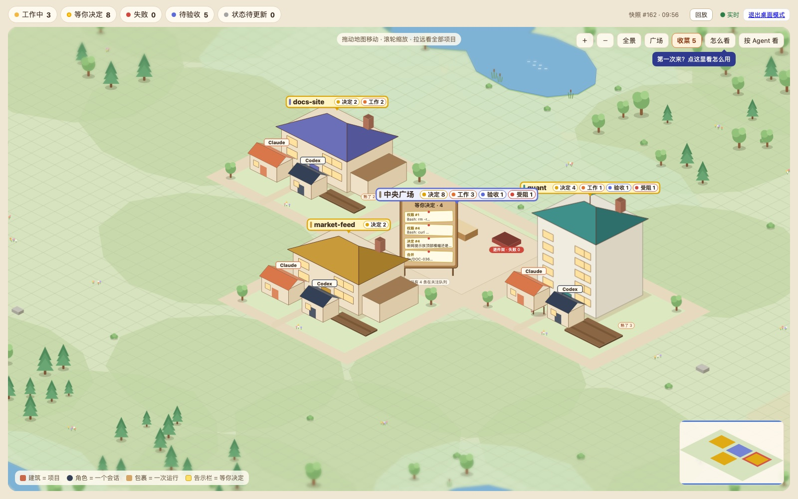
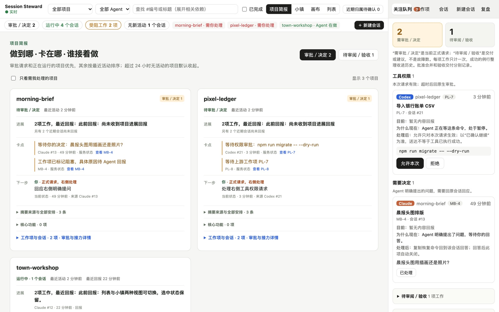

# Session Steward

给 Claude Code 和 Codex 用的本机进展与验收台。多个 Agent 同时在多个项目里干活时，Session Steward 让你在一分钟左右看懂：每个项目做到哪了、卡在哪、下一步谁来做、哪些事在等你。

[完整使用手册](docs/GUIDE.zh-CN.md) · [安全策略](SECURITY.md) · MIT 许可证 · [English summary](#english-summary)

> **状态：早期，欢迎试用和反馈。** 作者在 macOS 上日常使用；界面目前只有中文。Linux 可以构建并运行核心服务，测试较少；Windows 能编译，尚未测试。



## 能做什么

- **按项目看简报。** Claude Code 和 Codex 的会话按项目和工作项归并，每个项目显示阶段、一句话结论、卡点、下一步和负责人，而不只是一长串会话。
- **一个队列放所有等你的事。** 工具权限请求、Agent 的明确提问、等待批准的合并、等待验收的交付都在右侧队列里。
- **在面板里批准或拒绝工具权限。** 每个决定绑定到具体请求（工具、参数、工作目录），迟到的决定不会作用到另一个请求上；面板不在线时，Agent 回到自己的原生确认。
- **“Agent 说做完了”不等于“已验收”。** 进展和交付由 Agent 自己回报，只有你能把工作标为已验收。Stop、沉默或会话空闲都不算完成。
- **工作小镇。** 把当前工作画成桌上的微缩工作室，适合挂在副屏上随时瞄一眼（见下文）。
- **可选功能**，未配置时不生效：独立 worktree + tmux 中的托管会话和只读实时终端、带检查门的本地合并、跨 Agent 交接包、按工作项统计 token 用量、macOS 通知、经你自己的私有网络只读远程查看。



## 工作方式

```
Claude Code / Codex hooks ──> steward-hook ──> steward serve (127.0.0.1:7788) ──> Web 面板
                                   │                 │
                                   └ 本地暂存         └ SQLite（~/.steward）
```

`steward` 是一个 Go 单二进制，内嵌 Web 界面。`steward install` 为 Claude Code 和 Codex 追加 hook 条目，调用 `steward-hook` 把事件转发给本机服务。Agent 用 `steward-hook begin` / `report` / `deliver` 回报进展；hooks 会在每个会话开始时给它一段可直接照做的说明。

## 安装

> 数据只存在你自己电脑的 `~/.steward`，仓库里不带任何人的工作记录。拉下代码、装好以后面板是空的，这是正常的：先看下面的演示数据，或正式安装 hooks 后让 Agent 干活。

### 一行安装（macOS 预编译版本）

不想装 Go 时，用 GitHub Release 里编好的版本（arm64 / Intel 都有，未签名）：

```sh
curl -fsSL https://raw.githubusercontent.com/xoqiu09/session-steward/main/scripts/install.sh | sh -s -- --setup
```

脚本只下载 Release 文件并校验 SHA256，装到 `~/.local/share/session-steward/current`；加 `--setup` 时会逐项询问是否装 hooks、是否开机自启。不加则只放好文件，按提示自己运行。也可以在 Release 页面下载对应架构的包，看里面的“安装说明.txt”。

### 从源码构建

需要 `git` 和 Go 1.26.5 及以上（见 `go.mod`）。构建好的 Web 界面已提交在仓库里，只有修改前端时才需要 Node。

```sh
git clone https://github.com/xoqiu09/session-steward
cd session-steward
go build -ldflags "-X main.BuildCommit=$(git describe --always --dirty)" -o bin/ ./cmd/...
```

- `bin/steward` 和 `bin/steward-hook` 要放在同一个目录；仓库放在一个长期不动的位置。
- `-ldflags` 注入 `steward version` 显示的版本号（`make go` 会自动加上），省略时显示 `dev`。
- `steward install` 会把 `steward-hook` 复制到 `~/.steward/bin/`，hooks 调用的是这份副本。**重新构建后请再运行一次 `bin/steward install`**，否则 hooks 仍使用旧版本。

## 先用演示数据看一眼

使用独立的数据目录和端口，不会碰 `~/.steward`、`~/.claude` 或 `~/.codex`。需要 `python3`、`curl` 和 `git`。

```sh
export STEWARD_HOME=/tmp/steward-demo && mkdir -p "$STEWARD_HOME"
echo '{"listen":"127.0.0.1:7799","history_days":0}' > "$STEWARD_HOME/config.json"
bin/steward serve        # 终端 1，保持运行
```

```sh
export STEWARD_HOME=/tmp/steward-demo
scripts/demo.sh          # 终端 2
bin/steward open         # 打印登录链接并打开面板
```

看完在终端 1 按 Ctrl+C 停掉即可。

## 正式使用

在一个没有设置 `STEWARD_HOME` 的终端里：

```sh
bin/steward serve            # 在 127.0.0.1:7788 启动服务（或用下面的后台常驻）
bin/steward install          # 为 Claude Code 和 Codex 添加 hooks（或：install claude|codex）
bin/steward status           # 列出还没完成的项
bin/steward open             # 打印登录链接并打开面板
```

- `install` 只在 `~/.claude/settings.json` 和 `~/.codex/hooks.json` 中追加自己的条目（标记为 `--mark=steward-v1`），会先备份原文件，其他工具的 hooks 保持不变。`bin/steward uninstall` 只恢复或移除这些条目。
- Codex 需要你在 Codex 里信任新的 hooks 后才会运行。
- 之后新会话就会出现在面板里。Agent 按 hooks 给的说明登记和回报后，项目简报和小镇才有内容。详见[使用手册](docs/GUIDE.zh-CN.md#先用一个真实任务验证价值)。

### 后台常驻（macOS）

```sh
bin/steward service install    # 注册为当前用户的 LaunchAgent：登录后自动启动，退出后自动拉起
bin/steward service status
bin/steward service restart    # 重新构建 steward 后运行
bin/steward service uninstall
```

- 同一个 `STEWARD_HOME` 和端口只能有一个 `serve`：安装前先停止手动启动的 `steward serve`（端口被占用时 `install` 会拒绝）。
- plist 指向执行 `install` 时那个 `steward` 的绝对路径；在原位置重新构建后运行 `service restart`，换了位置就重新 `install`。
- 日志写在 `$STEWARD_HOME/logs/`（默认 `~/.steward/logs/`）。Linux 暂不支持，请用 `bin/steward serve` 或自己的 systemd 用户服务。详见[使用手册](docs/GUIDE.zh-CN.md#后台常驻macos-launchd)。

更新：`git pull --ff-only`，重新构建，`bin/steward install`，`bin/steward service restart`。

## 工作小镇

面板顶部视图切换里的“小镇”，或直接打开：

- `http://127.0.0.1:7788/?view=town`：进入小镇；
- `http://127.0.0.1:7788/?kiosk=1`：全屏桌面模式，隐藏其他界面，项目多时自动轮播（`&rotate=秒数` 调整间隔），适合常开在副屏上。

画面里的东西对应真实数据：

| 画面 | 含义 |
| --- | --- |
| 建筑 | 一个项目；招牌上方列出最多两项当前任务（待验收、受阻优先） |
| 带编号的小人 | 一个近期会话；同一 Agent 的多个会话是不同的人 |
| 工位上的纸箱 | 一次还没结束的运行 |
| 退件架 | 近一天失败的运行 |
| 你的验收台 | 等你验收的工作项 |
| 告示栏、举牌 | 需要你处理的请求，与顶部“审批／决定”同一口径 |
| 灰色、云朵 | 状态待更新：长时间没有新事件，不当作仍在工作 |

小镇只读：点选角色、包裹或告示卡，打开的是原有的会话或工作项详情，审批和验收仍在原处处理。小镇不批准、不验收、不派单。连接中断时画面变灰并注明停在哪一刻。没有 Agent 在干活时小镇会比较空，这是正常的。

## 在其他设备上查看（只读）

用 `tailscale serve` 只在你的 tailnet 内转发面板，在 `config.json` 的 `remote_hosts` 填主机名后运行 `steward service restart`，再用 `steward remote` 生成远程登录链接。远程端只能查看，审批和验收回本机做。步骤见[在其他设备上查看小镇](docs/GUIDE.zh-CN.md#在其他设备上查看小镇只读)。

**不要**用 `tailscale funnel` 或公网代理暴露面板。

## 隐私与安全

- 在本机运行，只监听回环地址，`Host` 不是回环地址的请求会被拒绝。没有遥测。
- 两个随机 token，权限 `0600`：一个给 hooks（只能访问 `/hook/*`），一个给面板（只能访问 `/api/*`，使用 HttpOnly、SameSite=Strict 的 cookie，写操作还要检查 Origin 和 `X-Steward`）。`steward open` 打印的登录链接含面板 token，不要发给别人。
- 存储的是脱敏后的事件元数据（事件类型、工具名、指纹、截断并遮蔽密钥的预览），不存原始载荷或完整对话。
- 只有你配置了才会访问网络：`ntfy_url`、`summary_command` 或 `remote_hosts`。远程访问是只读的，使用单独的 token；反向代理必须保留原始 `Host` 头，否则远程请求会被当作本机请求而无法登录。

发现安全问题请按 [SECURITY.md](SECURITY.md) 私下报告，不要开公开 Issue。

## 参与测试与反馈

欢迎在 [Issues](https://github.com/xoqiu09/session-steward/issues) 里反馈。为了能复现，请附上：

- 系统和版本：`bin/steward version`，以及你用的 Claude Code / Codex 客户端和版本；
- 发生了什么、你期望的是什么；
- 截图（项目简报、小镇或详情抽屉）。截图前确认里面没有不想公开的项目名或内容，**不要贴登录链接、token、`~/.steward` 下的文件或对话全文**。

## 开发

```sh
make build     # 在 web/ 里 npm ci && npm run build，再 go build（注入版本号）
make test      # go test -race ./... 和 web 下的 npm test
make notifier  # 仅 macOS：带深链跳转的通知助手应用
```

- 改 Go：`go test ./...`，状态机或并发相关再跑 `go test -race ./...`。
- 改前端：在 `web/` 里 `npm test` 和 `npm run build`，并提交重新构建的 `web/dist`（CI 会检查）。
- 测试和演示只用合成数据；开发约定见 [AGENTS.md](AGENTS.md)。

目录：`cmd/steward`（服务与命令行）、`cmd/steward-hook`（hook 适配器）、`internal/`（核心状态机、存储、服务端、安装、通知、后台服务）、`web/`（React + Vite，小镇在 `web/src/town/`）、`native/macos`（Swift 通知助手）。

## 许可证

[MIT](LICENSE)

## English summary

Session Steward is a local progress and acceptance desk for Claude Code and Codex. Hooks forward session events to a single Go binary listening on `127.0.0.1:7788`; the web panel groups work by project, shows what each agent is doing, what is blocked and what is waiting for you, and lets you approve tool permissions in place. Only you can mark work as accepted. A read-only “town” view (`?view=town`, full-screen `?kiosk=1`) draws the same live data as a miniature workshop. Status: early; the UI is Chinese-only; used daily on macOS. Build with Go 1.26.5+ (`go build -o bin/ ./cmd/...`), try it with demo data via `scripts/demo.sh`, then `bin/steward install` and `bin/steward service install` (macOS). Feedback is welcome in Issues; report security issues privately per [SECURITY.md](SECURITY.md).
