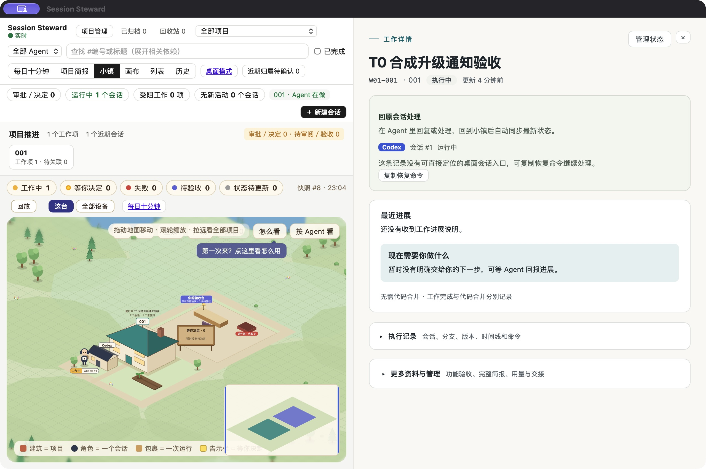
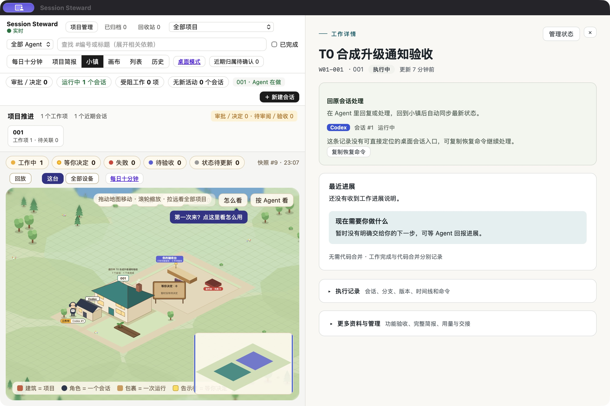

# T0：升级前后的通知跳转证据

这些截图来自独立身份、独立数据目录、独立 URL scheme 的隔离 App，只有虚构工作项 W01-001「T0 合成升级通知验收」，未使用正式项目、对话或数据库。

在成功事务前后各发送一条真实 macOS 合成通知，由用户实际点开；用户确认打开成功，CUA 再读回详情并留图。工作项保持执行中，未批准或验收。交互事务通过。

| 时点 | 确认结果 |
| --- | --- |
| 升级前 | 通知助手记录 opened_app，用户确认“打开了”，详情为 W01-001 |
| 升级后 | 新通知助手记录 opened_app，用户确认同一任务，详情仍为 W01-001 |

隔离事务使用同一源码候选模拟文件替换，验证停止、替换、重启和健康检查；不是跨正式版本的发布演练。构建代码候选为 `001ff10374d5d7aed175274650d3b07ea45088fd`；后续提交仅补充本证据。

其他本机验证：Go 普通和竞态各 554 项通过，静态检查通过；前端 379/379；原生链接/提醒纯检查 59+12；ARM/Intel 构建及嵌套签名通过；自管后台/共用 launchd 各成功与失败恢复，4/4 通过。

真实横幅点击覆盖自管模式的成功事务。恢复后的链接登记与通知助手替换由单元测试及真实四场景恢复矩阵覆盖，未单独点验恢复后的横幅。Intel 硬件、正式签名/公证、跨版本及两台正式机器升级留待发布阶段。

本轮没有合并、发布或替换正式安装；合成 App、运行数据、LaunchAgent 均已清理。完整测试日志保存在本轮本地交付目录，不含生产签名密钥。
