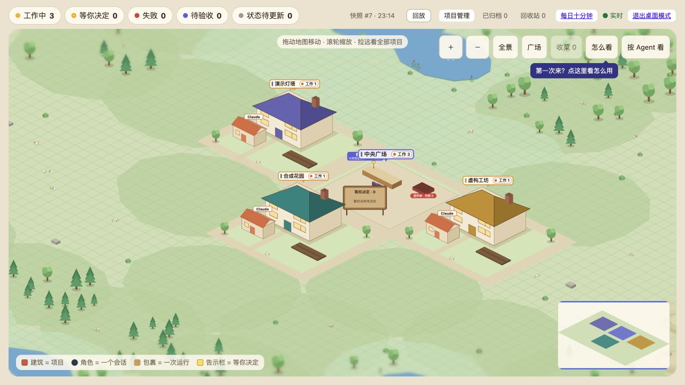
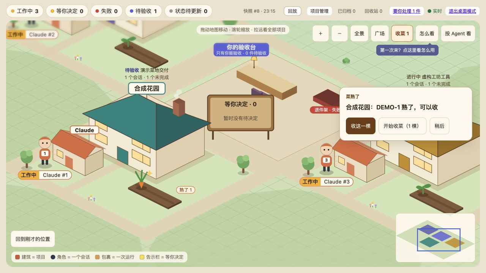
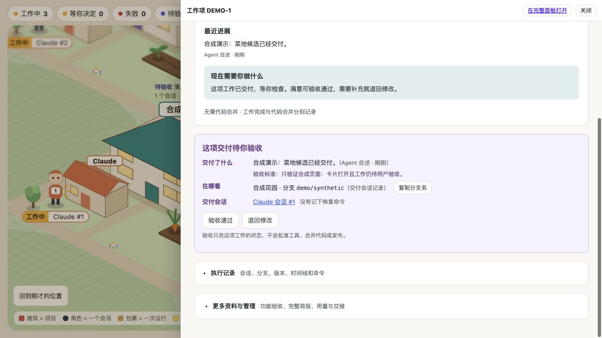
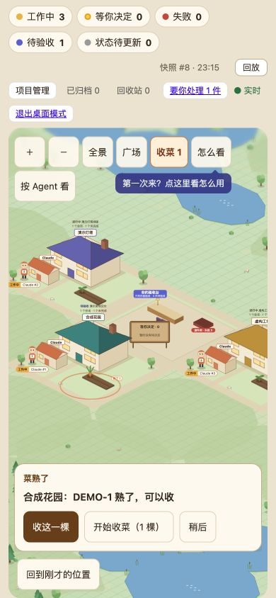

# V1 合成页面验证

这是 Agent 的本地自测记录，用户尚未验收，也没有更新正式安装。只覆盖 V1 世界地图，未包含 P1/P2/P3 或 Computer History。

2026-10-29 在独立、只绑定 127.0.0.1 的合成 HTTP 服务运行本分支 `web/dist`，没有连接真实 SS。所有项目、工作项、会话均为虚构。通过隐藏 CUA 浏览器实际操作，未以脚本替代页面点击。

- 代码候选：`11b380ca2cc0c4871493fe54a95dd5b1acf048b2`；构建资源 `index-H9QAcNaR.js` / `index-C2ey8WfJ.css`。
- `npm test`：54 个文件，413 项全部通过；`npm run build` 通过，保留原有大包体积提示。
- 用户已澄清时序：保留默认 3 秒归并窗口，随后约 900ms 飞行；不要求原示例的 1～2 秒端到端。
- 新动态出现后点“收这一棵”，现有 `DEMO-1` 验收卡片打开。没有点击“验收通过”或“退回修改”；工作项仍为 `review`，合成服务的 API 写入记录为 0。
- 390×844：没有横向溢出；卡片与目标菜地、返回按钮互不重叠；新卡片和返回按钮高度均为 44px。
- 自动聚合/优先级、30 秒保护、各阻止状态、远端只入队、减少动态效果、稍后保留队列、20 秒恢复巡游和离开提示由纯函数及真实 WorldStage hook/timer 宿主测试覆盖。
- 未验证：真实安装、多设备现场、实际读屏播报、操作系统减少动态效果切换及用户视觉验收。没有 Go 改动。

## 飞行前

## 飞行后

## 打开验收卡片

## 窄屏

