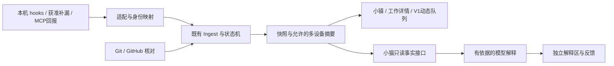

# SS 产品与接入：差异与补齐方案

状态：**设计文档草稿，待 Claude Code 独立审查；本 PR 不实现新功能。** 2026-10-30，Asia/Taipei。

这是原感知设计的独立补充，不覆盖 #34 或 #37/#38 的执行分支。原规范的冻结快照在 reference 中；其中历史状态不代表当前进度。

这份计划与现有感知架构方向一致。区别在于：它补充了“稳定世界、项目记忆、多工具接入”三类产品要求；现有实现主要是既有 hooks、有限的外部合并核对，以及已合并的世界交付体验。应复用已有模块，把感知缺口和升级链路优先补齐。

## 1. 本次核对的基线

下表是初版记录的固定基线，不是本次重新测试正式服务的结果。本轮仅确认 origin/main 仍为 ee4d590；P1/P3 表中候选保留为初版审查输入，其后续修订由各原 PR 单独记录。

| 项目 | 本次读回 |
| --- | --- |
| 远程 main / 本机正式服务 | `ee4d590b7a767646ff887984f32fccc27a2d8d50` |
| 本地工作状态 | 主仓库原有未跟踪内容保留；本 PR 从最新 origin/main 创建独立文档工作树。原有本地落后状态不作为功能基线。 |
| 感知设计分支 | `docs/perception-plan@6f621c29ff9b4a2c430ec96fd36f6500e90ef7d4`，#34 尚未合并 |
| P1 / #37 | OPEN、DRAFT，`97e949a1ec1f5908df406f4e82d97cacdbe51084` |
| P3 / #38 | OPEN、DRAFT，`e7f03d9dcd19e9e85700ec1622482b43ce559108` |
| 正式角色 | Mac Studio 为 hub；未改现有网络、密钥或工具配置 |

核对时间与固定候选见 [evidence/baseline.json](evidence/baseline.json)。本 PR 只增加本目录文档；不包含机器配置、数据库、运行日志、产品源码或安装替换。

## 2. 计划与实现的具体差异

| 计划要求 | 已有实现 | 缺口与补齐责任 |
| --- | --- | --- |
| 默认完整世界 | 普通小镇入口已经默认世界；工作室是独立模式。`town/route.ts`，#35 已合并。 | W1 只补入口一致性与回归，不重新开发世界入口。首次打开整个面板与进入“小镇”的默认页是两件事；本轮不擅自把所有深链重定向到地图。 |
| 项目稳定位置、切设备保持视角 | 已有世界、聚类和镜头。 | `world.ts` 按当前状态排序，`clusters.ts` 按近期活动分组；App 切换本机/全部设备时会更换 TownView key。确定性布局不等于跨状态稳定。W1 补稳定位置、常驻项目、分范围视角。 |
| 点名牌看花园、看片区、完整返回 | 已有 WorldStage 镜头/返回与操作保护；当前远景项目牌仍走 building Selection 进室内，片区牌未独立取景。 | 用户新增 W1 待实现契约：名牌/列表“去花园”立即定位，片区标题看全体成员，仅房子/明确工作室入口进室内；徽章保持原动作。完整返回视角及显示范围、30秒防抢镜、两设备同名不串位、零业务写入，由 W1/I0 的 S27 验收，本轮未实现或截图。 |
| 有成果定位、3 秒归并、返回原位置 | V1 已有 `moments.ts`、`useMoments.ts`、`WorldStage`：优先级、3 秒窗口、30 秒静默、详情/回放保护、定位卡片、返回镜头。 | W2 做恢复与持久去重加固和新来源映射，不另建事件队列或动画系统。 |
| 详情先讲发生什么、下一步 | 已有 `WorkOverview`；`RunDesk` 的技术资料已经收进“执行记录”。 | W1 补来源、核对时间、能力受限原因和处理入口；保留现有首屏，避免再把 SHA 放回首屏。 |
| 自由归档、删除、恢复项目 | `ProjectsPanel` 已有选择、批量归档、回收站和恢复。 | 复用现有入口；常驻与活跃分开。小镇“删除”是可恢复移除，不等于删除代码文件。归档项目默认不再通知。 |
| 外部合并及时更新 | 正式版 `merge_remote.go` 只查已登记 needs_merge 的工作。此前实测 #40 约 84 秒检出。 | 沿用现有 P2，补通用 PR 关联、关闭未合并、检查状态和共享预算；已有合并证据规则不得放宽。 |
| 来源、时间、信息缺口 | P1 有实现及候选测试，未合并和安装。 | F0 可先做隔离整合；正式 schema5 发布前，须先完成 U1 的 schema4 过渡升级器发布与目标设备安装，或由用户选择一次性手动迁移路线。不能把候选测试通过当成正式版已具备。 |
| Claude 新事件 | P3 有实现及合成测试，未合并和安装。 | 独立审查、整合和 MacBook 上真实项目级验证；不把普通人工拒绝当作自动模式拒绝。 |
| 执行工具与模型分开 | `provider` 目前主要表示工具；会话唯一键已经是 `(host_id, provider, provider_session_id)`。 | D0/A0 在旧语义上做增量扩展，保留现有隔离；模型是运行元信息，切换模型不新建会话。 |
| 结构化项目记忆 | 已有简报、交付、用户处理记录，以及普通记忆整理静默归档。 | 这些不等于版本化项目记忆库。新增 M1，补来源、适用版本、纠错和失效；不写 Codex/Claude 自身记忆目录。 |
| 小猫解释、发现矛盾 | 已有可调用摘要命令的 `ai_summaries`。 | 保留但不能冒充 P6。P6/P6b 补结构化事实、证据引用、解释、反馈、失效与节流。 |
| WorkBuddy / Harness | 本轮查到官方接入依据，未实现适配器。 | D0/A0 定契约；A1 固定 Harness 提交研究插件；A2 首期只做 WorkBuddy 主动 MCP 回报桥。桌面自动生命周期、返回指定会话仍是未知。 |
| 安装与运行验证 | T0/#33 已合并；正式版已有升级模块。 | U1 跨库升级未完成；P7 的“每项工作是否在某设备安装及运行验证”仍须单独做，不能用 App 版本字符串替代。 |

代码依据与官方资料见 [evidence/来源与状态.md](evidence/来源与状态.md)。上一轮候选检查见 [候选检查摘要](evidence/候选检查摘要.md)。

## 3. 应补进原计划的五项约束

1. **先整合，再扩展。** #37 与 main 的每日页面有源码冲突，#37/#38 彼此的规范化和回放也有冲突；F0 必须保留“已处理”、安静的记忆整理、V1 和既有多设备行为。各分支 CI 成功不能证明整合版正确。
2. **U1 必须先能升级 U1 自己。** 旧升级器会在迁移前按 schema 不同拒绝候选。拟议自动路线是先合并、发布仍为 schema4 的过渡升级器，并确认所有目标设备已安装，再正式发布 F0/schema5。另一条是用户明确选择一次性手动 schema4→5 迁移。两者尚待用户二选一；隔离整合可并行，正式发布门槛不能倒置。U1 另拟采用提交前拒收 hook 的维护屏障，保证回滚前不会确认随后被旧库覆盖的新事件，细节见 [U1](tasks/U1-schema-upgrade.zh-CN.md)。
3. **实时性先设计批量查询，再由用户决定承诺范围。** 每小时 300 次是全部仓库共享的实际请求上限，包含分页、重试和增量核查。P2 拟用 GraphQL 多仓库批量查询或 `gh search prs` 跨仓库搜索；30 仓库每分钟一轮若能单次覆盖，基础约 60 次/小时，变化 PR 再按精确候选追加核查。分批与分页必须实测计入预算，不能把一次命令当一次请求。保留“一分钟内感知”的待决目标，由用户选择是否承诺、覆盖哪些工作及异常边界；本 PR 既不取消该目标，也不声称已经能保证。见 [P2 补充约束](tasks/README.zh-CN.md#p2-补充约束)。
4. **来源渠道不等于事实等级。** hook、MCP 都可能包含 Agent 自述。D0 区分“自动观察／Agent 回报／程序核实／用户操作／模型解释”；不能因为接口连通就把全部能力标为已验证。
5. **普通工作叫“已处理”。** 保留用户最新文案决定。代码合并、功能符合要求、安装、运行验证仍各自独立；“已处理”不意味着这几类证据都成立。

## 4. 补齐后的架构

继续使用既有事件、Ingest、状态机、快照和 V1。新增工具只负责适配，不能自行创建另一套任务状态；小猫解释不走事实状态机。

字段、身份、能力、回查和权限提案见 [共用契约草案](architecture-addendum.zh-CN.md)。**图中新增模块是设计，不表示已经部署。**

## 5. 分批执行，保留原编号

| 批次 | 可以做什么 | 完成判断 |
| --- | --- | --- |
| 现在只准备 | D0 共用契约；A1/A2 官方资料和版本调研；P1/P3 独立审查。 | 文档、差异、合成输入及未知项可审查；不启用新工具采集。 |
| 地基整合与升级准备 | F0 在隔离环境整合 P1/P3；U1 先准备仍为 schema4 的过渡升级器和 schema4→5 恢复。 | 自动路线须先合并/发布 U1 过渡版、逐台确认目标设备已安装，才能正式发布 F0/schema5；手动路线须用户另选并验证恢复。整合、合并、发布、安装分别记录。 |
| 先解决每天遇到的问题 | P2 外部 PR；P4/P5 补漏与存活；W1 稳定世界；W2 复用 V1 加固。 | 外部动作、重连、状态变化不再产生误导；30+ 项目和跨设备场景通过。各任务按自己的依赖启动。 |
| 接工具与解释 | A0 公共接入；A1/A2 隔离原型；P6/P6b 小猫；M1 项目记忆。 | 工具/模型不混淆、能力逐项有证据；解释和记忆可纠正、不会擅自改变工作状态。 |
| 集成与真实验证 | P7 安装/运行记录；I0 接线、跨设备、真实工具、截图和记录。 | 逐条满足验收矩阵；不支持/未验证保留缺口；用户确认后再安排发布安装。 |

这里的批次不是“大串行”：D0 冻结后 W1/W2 可以用合成数据并行；W2 信号阶段等 P1，GitHub 阶段等 P2；M1 模型写入等 P6，不必等待所有工具适配。U1 不依赖 F0 先发布，schema 定义是协调输入；F0 的正式 schema5 发布反而受 U1 路线门槛约束。完整依赖和文件所有权见 [任务索引](tasks/README.zh-CN.md) 与 [依赖表](evidence/dependencies.json)。

## 6. 用户决定与待确认事项

保留决定台账：U08 已由用户决定“只参考、不接入、不复用代码/依赖”；U06、U07 已于 2026-10-31 决定（见下表与[派活台设计](../../../dispatch/design.zh-CN.md)）；新增 U09（手机走微信）未定；U01～U05 未定。新增 W1 也已由用户明确选择“先补任务书，暂不改界面”。本轮仅更新文档，不据此启动产品实现；模型记录授权不由工具接入推导。

| 编号 | 事项 | 状态与边界 |
| --- | --- | --- |
| U01 | 是否接入 WorkBuddy MCP，以及允许的测试项目和回报动作 | A2 只研究官方资料与合成契约；不注册 MCP、不改配置、不开始真实调用。 |
| U02 | 是否加载 Harness 旁挂观察插件，以及固定版本/profile | A1 只研究；不加载插件、不订阅真实事件。 |
| U03 | 是否记录执行模型的厂商/名称，以及字段、用途与保留范围 | 只保留契约设计，新增采集与持久化默认不启用；未知不猜测。 |
| U04 | P2 是否承诺一分钟内感知、覆盖哪些工作、网络/预算异常如何解释 | 批量查询只作为待验证设计；不删去目标，也不把它写成已承诺或已实现。 |
| U05 | schema4 过渡升级器先全目标安装，或一次性手动 schema4→5 | 未选路线不得正式发布 schema5；两条都须事件屏障、备份和故障恢复证明。 |
| U06 | 手机权限保守默认与最终确认，独立凭据签发/有效期/撤销，以及仅 CLI 回退 | **2026-10-31 已决定**：MacBook 和手机都可以“仅允许这一次”（不再是远端只能拒绝，每次仍核指纹和租约）；每台设备独立派活密钥，不过期，只能在 Mac Studio 上手动收回；“回电脑接着做”必须能回官方桌面 App，不接受仅 CLI 回退，先按 K2 点验。设计见[派活台](../../../dispatch/design.zh-CN.md)。普通远端仍只读，remoteBlocked 不变。 |
| U07 | 是否启用真实手机访问网络、使用何种已批准的连接路径 | **2026-10-31 已决定（MacBook）**：派活走 Tailscale 新端口 8444 → Studio 127.0.0.1:7790 独立监听，8443 与 hub 推送不动，由用户自己执行 `tailscale serve`，不开 Funnel。手机改走微信入口，另记 U09。 |
| U08 | Ekko 的参考方式 | **已决定**：不整套接入，只参考思路，按 SS 方式自实现个人使用；不复制或用 AI 改写其代码/依赖，不接入 Vue/Koa/profile/model-provider/workspace/session-library。固定参考 ba84e38、BSL1.1 作为出处记录，不作新的许可结论或复制授权。 |
| U09 | 手机是否通过微信 gateway（像 Hermes 一样）管理派活，微信里能出现哪些内容，允许靠什么确认 | **未定**：内容会经过微信和 gateway，与“审批内容不出用户设备”的现有规则冲突，需用户逐项决定；K4 只调研，不接入。 |

本机控制草案见 [契约第 6 节](architecture-addendum.zh-CN.md#6-仅控制执行设备的本机控制提案)。PR #42 仅是外部原型审查输入，尚未在本包验证或合入；S22～S26 都未执行。

### 本机控制第一阶段的五项范围（待实现/待逐项验证）

| 范围 | 方案与完成边界 |
| --- | --- |
| 手机发任务，固定 Mac Studio 执行 | 使用 SS 原有 WorkItem/Session/Run、项目和人物，不另建远程任务体系；不把 hub 变成其他设备控制器。 |
| 手机断开仍继续 | 任务在执行设备继续；重连仍是同会话，复用 V1“离开期间”提示，不把重连当新交付或用户已处理。 |
| 去原会话 | CLI resume 显式指定原生ID；桌面入口使用带明确ID的 codex://threads 方案。两者分别核同一ID与历史连续；带摘要新开聊天或只唤起App均不算接手，桌面真实能力仍未验证。 |
| 手机权限保守默认 | 手机暂只拒绝，允许/批准回执行设备本机；PR #42 先按此授权收紧远端allow，最终产品默认仍待用户确认。普通只读入口不因这一独立控制设计扩大权限，真实手机网络仍未定。 |
| Agent 明确交付才菜熟 | 明确交付进入 review/等用户处理；停止、恢复、模型回合结束不自动已处理，更不自动批准或写功能符合要求。模型设置仍归 Codex，UI 沿用 SS 小镇。 |

Ekko 只作可回查出处：[固定 LICENSE](https://github.com/EKKOLearnAI/ekko-studio/blob/ba84e38d20452b69059e2e2194f835505741ffd6/LICENSE)、[同提交服务入口](https://github.com/EKKOLearnAI/ekko-studio/blob/ba84e38d20452b69059e2e2194f835505741ffd6/packages/server/src/modules/coding-agents/services/index.ts)。本轮只读前次来源回执/许可证材料，不声称本轮重新核验上游；用户“不复用”的选择与来源/许可记录分开，不推导任何新复制许可。

## 7. 这次交付与下一步

本包提供 **15 份补充任务书、27 个待执行场景**、旧设计只读快照、接口草案及派发门槛。新增 [W1 手动导航契约](tasks/W1-stable-world.zh-CN.md#手动导航交互契约待实现) 与 S27，要求未来在30+合成项目、两设备同名、七项目片区实际点验“点击前/花园后/返回后”三截图和导航业务写入0；这些证据尚未生成。现有 P1/P2/P3/T0/V1 任务书复用，不重编号；后续 P4～P7 目前只是预备草案，依赖合入后必须重新对齐实际源码。

建议主线程先审查 D0、F0、U1；A1/A2 在用户决定前只可研究。契约冻结前，不让适配器和地图任务各自改公共类型。设计采用用户本次目标，字段与 API 仍是提案，不视为已批准的实现协议。本轮没有启动任何任务实现。

本 PR 将补充文档放入独立目录，没有改动 #34/#37/#38 或根 AGENTS.md。独立审查后由文档负责人决定如何并入正式架构、路线图与任务书；这份文档 PR 不代表新增功能实现或用户验收。

Claude Code 的审查入口见 [REVIEW.zh-CN.md](REVIEW.zh-CN.md)。
