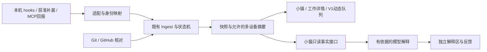

# SS 产品与接入：差异与补齐方案

状态：**设计文档草稿，待 Claude Code 独立审查；本 PR 不实现新功能。** 2026-10-30，Asia/Taipei。

这是原感知设计的独立补充，不覆盖 #34 或 #37/#38 的执行分支。原规范的冻结快照在 reference 中；其中历史状态不代表当前进度。

这份计划与现有感知架构方向一致。区别在于：它补充了“稳定世界、项目记忆、多工具接入”三类产品要求；现有实现主要是既有 hooks、有限的外部合并核对，以及已合并的世界交付体验。应复用已有模块，把感知缺口和升级链路优先补齐。

## 1. 本次核对的基线

| 项目 | 本次读回 |
| --- | --- |
| 远程 main / 本机正式服务 | `ee4d590b7a767646ff887984f32fccc27a2d8d50` |
| 本地工作状态 | 主仓库原有未跟踪内容保留；本 PR 从最新 origin/main 创建独立文档工作树。原有本地落后状态不作为功能基线。 |
| 感知设计分支 | `docs/perception-plan@6f621c29ff9b4a2c430ec96fd36f6500e90ef7d4`，#34 尚未合并 |
| P1 / #37 | OPEN、DRAFT，`97e949a1ec1f5908df406f4e82d97cacdbe51084` |
| P3 / #38 | OPEN、DRAFT，`e7f03d9dcd19e9e85700ec1622482b43ce559108` |
| 正式角色 | Mac Studio 为 hub；未改现有网络、密钥或工具配置 |

核对时间与固定候选见 [evidence/baseline.json](evidence/baseline.json)。本 PR 只增加本目录文档；不包含机器配置、数据库、运行日志、产品源码或安装替换。

## 2. 计划与实现的具体差异

| 计划要求 | 已有实现 | 缺口与补齐责任 |
| --- | --- | --- |
| 默认完整世界 | 普通小镇入口已经默认世界；工作室是独立模式。`town/route.ts`，#35 已合并。 | W1 只补入口一致性与回归，不重新开发世界入口。首次打开整个面板与进入“小镇”的默认页是两件事；本轮不擅自把所有深链重定向到地图。 |
| 项目稳定位置、切设备保持视角 | 已有世界、聚类和镜头。 | `world.ts` 按当前状态排序，`clusters.ts` 按近期活动分组；App 切换本机/全部设备时会更换 TownView key。确定性布局不等于跨状态稳定。W1 补稳定位置、常驻项目、分范围视角。 |
| 有成果定位、3 秒归并、返回原位置 | V1 已有 `moments.ts`、`useMoments.ts`、`WorldStage`：优先级、3 秒窗口、30 秒静默、详情/回放保护、定位卡片、返回镜头。 | W2 做恢复与持久去重加固和新来源映射，不另建事件队列或动画系统。 |
| 详情先讲发生什么、下一步 | 已有 `WorkOverview`；`RunDesk` 的技术资料已经收进“执行记录”。 | W1 补来源、核对时间、能力受限原因和处理入口；保留现有首屏，避免再把 SHA 放回首屏。 |
| 自由归档、删除、恢复项目 | `ProjectsPanel` 已有选择、批量归档、回收站和恢复。 | 复用现有入口；常驻与活跃分开。小镇“删除”是可恢复移除，不等于删除代码文件。归档项目默认不再通知。 |
| 外部合并及时更新 | 正式版 `merge_remote.go` 只查已登记 needs_merge 的工作。此前实测 #40 约 84 秒检出。 | 沿用现有 P2，补通用 PR 关联、关闭未合并、检查状态和共享预算；已有合并证据规则不得放宽。 |
| 来源、时间、信息缺口 | P1 有实现及候选测试，未合并和安装。 | F0 整合 P1/P3，再由 U1 打通跨库升级；不能把候选测试通过当成正式版已具备。 |
| Claude 新事件 | P3 有实现及合成测试，未合并和安装。 | 独立审查、整合和 MacBook 上真实项目级验证；不把普通人工拒绝当作自动模式拒绝。 |
| 执行工具与模型分开 | `provider` 目前主要表示工具；会话唯一键已经是 `(host_id, provider, provider_session_id)`。 | D0/A0 在旧语义上做增量扩展，保留现有隔离；模型是运行元信息，切换模型不新建会话。 |
| 结构化项目记忆 | 已有简报、交付、用户处理记录，以及普通记忆整理静默归档。 | 这些不等于版本化项目记忆库。新增 M1，补来源、适用版本、纠错和失效；不写 Codex/Claude 自身记忆目录。 |
| 小猫解释、发现矛盾 | 已有可调用摘要命令的 `ai_summaries`。 | 保留但不能冒充 P6。P6/P6b 补结构化事实、证据引用、解释、反馈、失效与节流。 |
| WorkBuddy / Harness | 本轮查到官方接入依据，未实现适配器。 | D0/A0 定契约；A1 固定 Harness 提交研究插件；A2 首期只做 WorkBuddy 主动 MCP 回报桥。桌面自动生命周期、返回指定会话仍是未知。 |
| 安装与运行验证 | T0/#33 已合并；正式版已有升级模块。 | U1 跨库升级未完成；P7 的“每项工作是否在某设备安装及运行验证”仍须单独做，不能用 App 版本字符串替代。 |

代码依据与官方资料见 [evidence/来源与状态.md](evidence/来源与状态.md)。上一轮候选检查见 [候选检查摘要](evidence/候选检查摘要.md)。

## 3. 应补进原计划的五项约束

1. **先整合，再扩展。** #37 与 main 的每日页面有源码冲突，#37/#38 彼此的规范化和回放也有冲突；F0 必须保留“已处理”、安静的记忆整理、V1 和既有多设备行为。各分支 CI 成功不能证明整合版正确。
2. **U1 是正式交付依赖。** P1 是 schema5，正式库是 schema4；现有升级器拒绝跨 schema。迁移、恢复旧库及补回期间事件要一起设计，不能只替换 App。
3. **实时性要有覆盖和预算。** 每小时 300 次请求是共享上限，不是每仓库额度。若 N 个仓库每轮各需 q 次请求，完整轮询理论下限为 `3600×N×q/300` 秒；30 仓库、每仓库 1 请求也需 6 分钟。优先处理活跃请求，展示上次核对与信息缺口，不承诺所有项目 60 秒内更新。
4. **来源渠道不等于事实等级。** hook、MCP 都可能包含 Agent 自述。D0 区分“自动观察／Agent 回报／程序核实／用户操作／模型解释”；不能因为接口连通就把全部能力标为已验证。
5. **普通工作叫“已处理”。** 保留用户最新文案决定。代码合并、功能符合要求、安装、运行验证仍各自独立；“已处理”不意味着这几类证据都成立。

## 4. 补齐后的架构

继续使用既有事件、Ingest、状态机、快照和 V1。新增工具只负责适配，不能自行创建另一套任务状态；小猫解释不走事实状态机。

字段、身份、能力、回查和权限提案见 [共用契约草案](architecture-addendum.zh-CN.md)。**图中新增模块是设计，不表示已经部署。**

## 5. 分批执行，保留原编号

| 批次 | 可以做什么 | 完成判断 |
| --- | --- | --- |
| 现在只准备 | D0 共用契约；A1/A2 官方资料和版本调研；P1/P3 独立审查。 | 文档、差异、合成输入及未知项可审查；不启用新工具采集。 |
| 地基整合 | F0 整合 P1/P3 到最新 main；U1 在隔离环境做 schema4→5 升级恢复。 | 整合候选完整回归、旧行为不丢；升级各失败点与事件补回验证通过。合并仍由用户决定。 |
| 先解决每天遇到的问题 | P2 外部 PR；P4/P5 补漏与存活；W1 稳定世界；W2 复用 V1 加固。 | 外部动作、重连、状态变化不再产生误导；30+ 项目和跨设备场景通过。各任务按自己的依赖启动。 |
| 接工具与解释 | A0 公共接入；A1/A2 隔离原型；P6/P6b 小猫；M1 项目记忆。 | 工具/模型不混淆、能力逐项有证据；解释和记忆可纠正、不会擅自改变工作状态。 |
| 集成与真实验证 | P7 安装/运行记录；I0 接线、跨设备、真实工具、截图和记录。 | 逐条满足验收矩阵；不支持/未验证保留缺口；用户确认后再安排发布安装。 |

这里的批次不是“大串行”：D0 冻结后 W1/W2 可以用合成数据并行；P6 只依赖自己的事实接口，不必等待所有工具适配；U1 的设计与 F0 可并行，实际 schema 与迁移入口由同一负责人协调。完整依赖和文件所有权见 [任务索引](tasks/README.zh-CN.md)。

## 6. 这次交付与下一步

本包提供 **15 份补充任务书**、旧设计只读快照、接口草案、合成验收矩阵及派发门槛。现有 P1/P2/P3/T0/V1 任务书复用，不重编号；后续 P4～P7 目前只是预备草案，依赖合入后必须重新对齐实际源码。

建议主线程先审查 D0、F0、U1；同时安排 A1/A2 的研究阶段。契约冻结前，不让适配器和地图任务各自改公共类型。设计采用用户本次目标，字段与 API 仍是提案，不视为已批准的实现协议。

本 PR 将补充文档放入独立目录，没有改动 #34/#37/#38 或根 AGENTS.md。独立审查后由文档负责人决定如何并入正式架构、路线图与任务书；这份文档 PR 不代表新增功能实现或用户验收。

Claude Code 的审查入口见 [REVIEW.zh-CN.md](REVIEW.zh-CN.md)。
